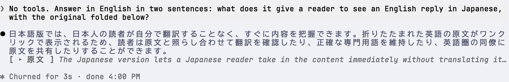

# dubbed

Shows Claude's non-Japanese replies in Japanese, with the original folded below. The reply itself is left as written.

It translates with [PLaMo 3 Translate](https://huggingface.co/collections/pfnet/plamo-3-translate) on a completions endpoint, set in `/config` as `endpoint` and `model` (by default `http://127.0.0.1:9931/v1/completions` and `plamo-3-translate-2b`).
