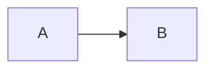

# mermaid-svg

Links an SVG, drawn by [pele](https://pele.run), below each mermaid block in Claude's replies.

````

󰋩 SVG ↗
````

In the terminal the block becomes an image, which needs [ImageMagick](https://imagemagick.org). The icon needs a [Nerd Font](https://www.nerdfonts.com).
