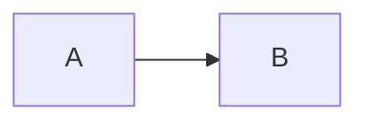

# mermaid-svg

A Claude Code mod that writes each mermaid block in Claude's replies to an SVG file with [pele](https://pele.run) and links the file right below the block.

````

󰋩 SVG ↗
````

The reply still shows the mermaid source; only the link is added, and only on screen, so what Claude reads stays as written.
Cmd- or Ctrl-click the link to open the SVG.
A block pele cannot read gets no link.

The SVG goes under `$TMPDIR/mermaid-svg/` (`%TEMP%` on Windows, `/tmp` when neither is set).
The link label uses a [Nerd Font](https://www.nerdfonts.com) icon.

## Install

```sh
claude plugin marketplace add h3y6e/claude-plugins
claude plugin install mermaid-svg@h3y6e
```
