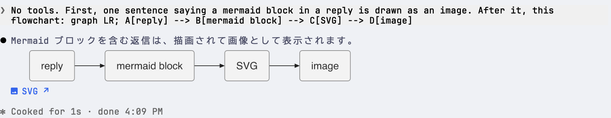

# mermaid

Claude の返信の mermaid ブロックごとに、[pele](https://pele.run) で描いた SVG へのリンクを下に付けます。



## インストール

```sh
claude plugin marketplace add h3y6e/claude-plugins
claude plugin install mermaid@h3y6e
```

ターミナルではブロックを画像で表示するため、[ImageMagick](https://imagemagick.org) が必要です。アイコンの表示には [Nerd Font](https://www.nerdfonts.com) が必要です。
