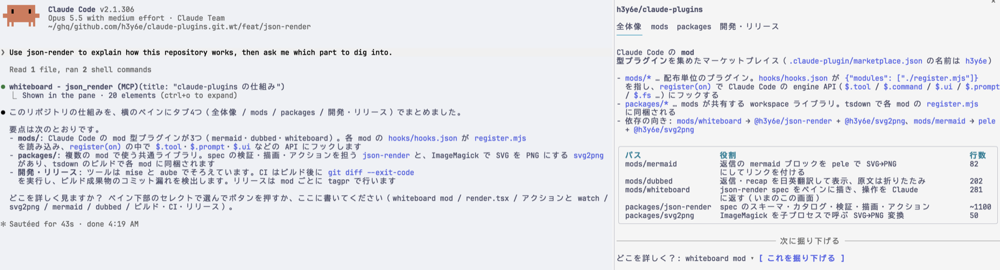

# napkin

[json-render](https://json-render.dev) の spec を、チャットの横のペインに描きます。ペインで選んだり入力したりした内容は、次のプロンプトになります。

spec の書き方は Claude が既に知っているので、書き方をツールの定義に載せずに済み、毎ターンのコンテキストがほとんど増えません。



## インストール

```sh
claude plugin marketplace add h3y6e/claude-plugins
claude plugin install napkin@h3y6e
```

ターミナルで Chart と Image を画像で表示するため、[ImageMagick](https://imagemagick.org) が必要です。

## 使い方

「json-render で〜を見せて」のように頼みます。ペインは `/napkin` で出し入れでき、`ctrl+x tab` でペインを操作できます。
