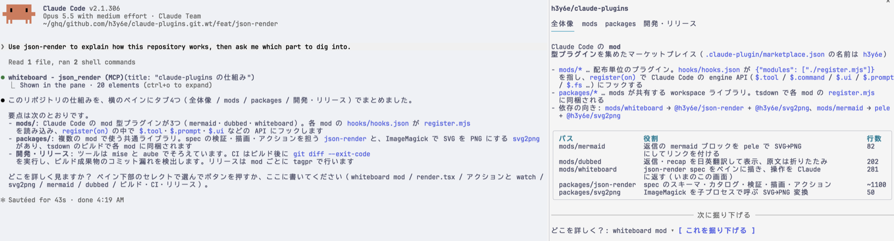

# whiteboard

Claude が書いた [json-render](https://json-render.dev) の spec を、チャットの横のペインに描きます。ペインで選んだり入力したりした内容は、次のプロンプトとして Claude に返ります。



部品は Claude Code の UI 要素に合わせた独自のカタログで、名前は [shadcn 版](https://json-render.dev/docs/api/shadcn) に揃えています（Stack、Card、Collapsible、Tabs、Separator、Heading、Text、Markdown、Code、Link、Badge、Alert、Table、Chart、Progress、Spinner、Image、Button、Input、Select、Checkbox）。描画は [packages/json-render](../../packages/json-render) が受け持ちます。

## インストール

```sh
claude plugin marketplace add h3y6e/claude-plugins
claude plugin install whiteboard@h3y6e
```

ターミナルで Chart と Image を画像で表示するため、[ImageMagick](https://imagemagick.org) が必要です。画像を出せない端末では、代わりに文字のグラフや説明が出ます。

## 使い方

「json-render で〜を出して」のように頼むと、Claude が `json_render` ツールで spec を描きます。カタログに合わない spec は描かずに問題点を Claude に返すので、Claude は直した spec を送り直します。

`setState`・`pushState`・`removeState` はペインの中で state を更新し、それ以外のアクションは、その params と state を添えて Claude に送られます。`watch` は state が変わるとアクションを実行し、`confirm` 付きのアクションは送る前に確認ダイアログ（`y` / `n`）を出します。

ツールの行の下には、Edit の差分のように要約が出ます。spec の中身は、ペインが描かれないときはそこに出て、描かれたときも `ctrl+o` で広げれば見られます。

ペインは `/diff` と同じく右側に置かれ、`/whiteboard` で出し入れできます。Claude が開くペインは、ターミナルの幅が足りないと描かれないので、そのときも `/whiteboard` で開いてください。`ctrl+x tab` でペインにキーボードを移すと、Tab で入力欄やボタンを移り、矢印キーやホイールでスクロールできます。

Claude Code Desktop・VS Code・モバイルアプリでも描きます。Chart と Image は SVG のまま描き、モバイルアプリでは Select を選択肢のボタンで描きます。
